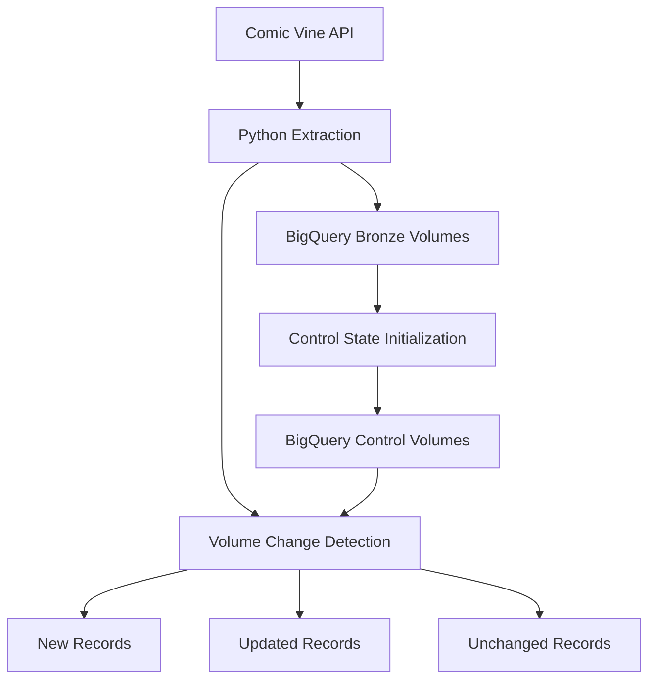
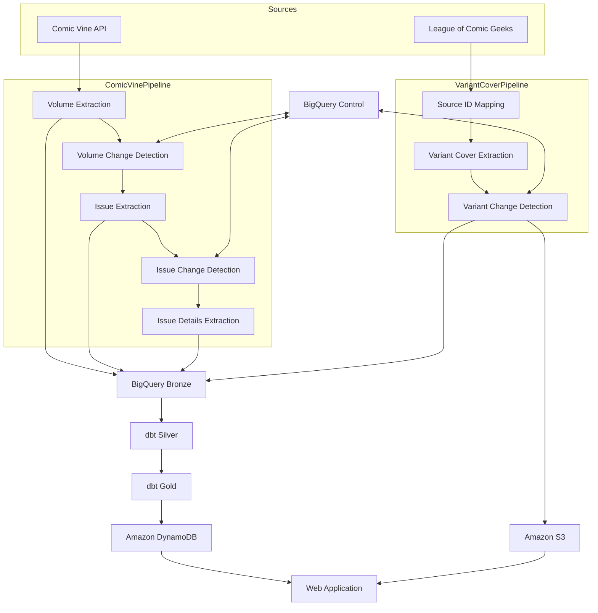

# Absolute Pipeline

An end-to-end data engineering project designed to collect, process, store, and serve comic book metadata and variant covers from DC Comics' Absolute Universe.

The project focuses on incremental data ingestion, efficient API consumption, data quality, historical tracking, cloud infrastructure, and automated data pipelines.

**Project status:** In development — Incremental Volume Ingestion.

## Overview

Absolute Pipeline integrates two independent data sources:

- **Comic Vine:** Primary source for comic book volumes, issues, and detailed issue metadata.
- **League of Comic Geeks (LoCG):** Secondary source for variant cover metadata and cover images.

The data will eventually power a web application where users can explore the Absolute Universe, browse comic book releases, and discover their variant covers.

The project is also intended as a hands-on learning experience covering the complete data engineering lifecycle, from source exploration to production deployment.

## Objectives

- Build a reliable and maintainable data ingestion pipeline.
- Minimize external API calls through cascading incremental extraction.
- Preserve historical source records.
- Detect new and modified records using content hashing.
- Maintain synchronization state across pipeline executions.
- Implement idempotent data processing.
- Transform raw data into analytics-ready and application-ready datasets.
- Collect variant cover metadata through an independent pipeline.
- Automate infrastructure provisioning and pipeline execution.
- Serve curated comic book metadata and cover images through a web application.

## Architecture

### Current Architecture



Initial volume ingestion, control state initialization, and volume change detection have been implemented.

Incremental persistence and reusable Python modules are the next development steps.

### Target Architecture



The target architecture is subject to refinement as the project evolves. The orchestration, deployment, and serving-layer technologies have not been finalized.

## Technology Stack

| Technology            | Purpose                               | Status           |
| --------------------- | ------------------------------------- | ---------------- |
| Python 3.13           | Data ingestion and processing         | Implemented      |
| uv                    | Dependency and environment management | Implemented      |
| Jupyter               | Data exploration and prototyping      | Implemented      |
| requests              | HTTP client                           | Implemented      |
| pandas                | Data exploration and validation       | Implemented      |
| python-dotenv         | Environment configuration             | Implemented      |
| Google BigQuery       | Data warehouse                        | Implemented      |
| hashlib / SHA-256     | Record change detection               | Implemented      |
| BeautifulSoup         | Variant cover HTML parsing            | Proof of concept |
| Hatchling             | Python package management             | Planned          |
| pytest                | Automated testing                     | Planned          |
| Ruff                  | Linting and formatting                | Planned          |
| dbt                   | Data transformation                   | Planned          |
| Google Cloud Storage  | Optional raw object storage           | Under evaluation |
| Google Cloud Run Jobs | Pipeline execution                    | Proposed         |
| Apache Airflow        | Pipeline orchestration                | Under evaluation |
| Terraform             | Infrastructure as Code                | Planned          |
| GitHub Actions        | CI/CD                                 | Planned          |
| Amazon S3             | Cover image storage                   | Proposed         |
| Amazon DynamoDB       | Application serving layer             | Proposed         |

## Data Sources

### Comic Vine

Comic Vine is the primary source of comic book metadata.

- Website: https://comicvine.gamespot.com/
- API: https://comicvine.gamespot.com/api/

The pipeline will consume the following resources:

| Resource      | Description                                |
| ------------- | ------------------------------------------ |
| Volumes       | Comic book series and volume metadata      |
| Issues        | Individual comic book issues               |
| Issue Details | Detailed information for individual issues |

The initial volume discovery process searches for volumes containing the term `Absolute`.

A preliminary tracking rule identifies relevant volumes using:

- DC Comics as the publisher.
- A starting year of 2024 or later.
- Exclusion of unrelated Absolute Power volumes.

This rule is provisional and will eventually be replaced or complemented by an explicitly maintained catalog of tracked volumes.

Raw source records are preserved independently of these filtering rules.

### League of Comic Geeks

League of Comic Geeks is the selected secondary source for variant cover information.

- Website: https://leagueofcomicgeeks.com/

Example series:

https://leagueofcomicgeeks.com/comics/series/178012/absolute-batman

Example issue:

https://leagueofcomicgeeks.com/comic/1669159/absolute-batman-23

Variant covers are collected independently from Comic Vine and are not part of the Comic Vine ingestion pipeline.

#### API Investigation

The Himon Python library was identified as a potential API client.

- Repository: https://github.com/Buried-In-Code/Himon
- Documentation: https://himon.readthedocs.io/en/stable/

Himon documents support for comic variants and cover metadata. However, official API access, credential availability, and image URL retrieval have not been confirmed.

Himon is not currently a project dependency.

#### HTML Extraction Proof of Concept

An initial HTML extraction experiment was successfully performed using `requests` and `BeautifulSoup`.

Initial HTTP requests returned a Cloudflare HTTP 403 response. A subsequent request using an application-identifying User-Agent and standard HTTP headers returned HTTP 200.

The retrieved page contained the expected comic information and variant cover links.

| Validation                  | Result                      |
| --------------------------- | --------------------------- |
| Comic                       | Absolute Batman #23         |
| LoCG series ID              | 178012                      |
| LoCG issue ID               | 1669159                     |
| HTTP status                 | 200                         |
| Page title                  | Absolute Batman #23 Reviews |
| Variant links discovered    | 144                         |
| HTML parsing                | Successful                  |
| Browser automation required | Not for the tested request  |
| Unique variant count        | Pending validation          |
| Image completeness          | Pending validation          |

Each variant link contains useful metadata, including:

- Issue identifier.
- Variant identifier.
- Variant title.
- Full comic and variant title.
- Cover image URL.
- Variant page URL.

Example extracted record:

```json
{
    "issue_id": 1669159,
    "variant_id": 2337629,
    "variant_name": "Cover B Jeffrey Spokes Variant",
    "full_title": "Absolute Batman #23 Cover B Jeffrey Spokes Variant",
    "image_url": "https://s3.amazonaws.com/comicgeeks/comics/covers/medium-2337629.jpg?1791656318",
    "variant_url": "https://leagueofcomicgeeks.com/comic/1669159/absolute-batman-23?variant=2337629"
}
```

Cover images use lazy loading. Their original URLs are available through the HTML `data-src` attribute.

This makes it technically possible to extract multiple variant cover records from a single issue page without requesting every individual variant page.

#### Access and Usage Constraints

The inspected `robots.txt` contains:

```text
User-agent: *
Crawl-delay: 30.00
```

The proposed extraction strategy will respect a minimum 30-second interval between page requests and avoid concurrent requests.

Successful HTML retrieval does not establish permission to scrape, download, store, or redistribute content.

Automated access permissions, terms of use, image usage rights, and long-term extraction stability must be verified before production implementation.

The variant cover pipeline is deferred until the primary Comic Vine pipeline is completed.

## Data Architecture

The project follows a layered data architecture using BigQuery.

### Bronze Layer

The Bronze layer stores raw source records with minimal transformations.

Records are append-only, allowing historical versions of source data to be preserved.

| Table                   | Description                       | Status      |
| ----------------------- | --------------------------------- | ----------- |
| `bronze.volumes`        | Raw Comic Vine volume records     | Implemented |
| `bronze.issues`         | Raw Comic Vine issue records      | Planned     |
| `bronze.issue_details`  | Detailed Comic Vine issue records | Planned     |
| `bronze.variant_covers` | Raw LoCG variant cover records    | Planned     |

#### Volume Schema

Table: `bronze.volumes`

| Column              | Type      | Mode     |
| ------------------- | --------- | -------- |
| `volume_id`         | INT64     | REQUIRED |
| `payload`           | JSON      | REQUIRED |
| `source_updated_at` | TIMESTAMP | NULLABLE |
| `extracted_at`      | TIMESTAMP | REQUIRED |
| `run_id`            | STRING    | REQUIRED |

Partitioning:

- Daily partitioning by `extracted_at`.

Clustering:

- `volume_id`.

The original source response is preserved in the `payload` column.

The `source_updated_at` field remains nullable until the source timestamp format and timezone semantics are validated.

### Control Layer

The Control layer maintains synchronization state independently from historical Bronze records.

| Table                           | Purpose                             | Status      |
| ------------------------------- | ----------------------------------- | ----------- |
| `control.volumes`               | Volume synchronization state        | Implemented |
| `control.volumes_staging`       | Temporary volume state loading      | Implemented |
| `control.issues`                | Issue synchronization state         | Planned     |
| `control.issue_details`         | Issue detail synchronization state  | Planned     |
| `control.pipeline_runs`         | Pipeline execution tracking         | Planned     |
| `control.api_usage`             | API request monitoring              | Planned     |
| `control.sync_state`            | Downstream synchronization tracking | Planned     |
| `control.volume_source_mapping` | Comic Vine to LoCG volume mapping   | Planned     |
| `control.issue_source_mapping`  | Comic Vine to LoCG issue mapping    | Planned     |
| `control.variant_covers`        | Variant cover synchronization state | Planned     |

#### Volume Control Schema

Table: `control.volumes`

| Column              | Type      | Mode     |
| ------------------- | --------- | -------- |
| `volume_id`         | INT64     | REQUIRED |
| `issue_count`       | INT64     | NULLABLE |
| `last_issue_id`     | INT64     | NULLABLE |
| `source_updated_at` | TIMESTAMP | NULLABLE |
| `last_checked_at`   | TIMESTAMP | REQUIRED |
| `last_fetched_at`   | TIMESTAMP | REQUIRED |
| `record_hash`       | STRING    | REQUIRED |
| `is_tracked`        | BOOL      | REQUIRED |
| `run_id`            | STRING    | REQUIRED |

Important field definitions:

- `issue_count`: Number of issues reported by the source, not the number currently stored in BigQuery.
- `last_checked_at`: Most recent successful source verification.
- `last_fetched_at`: Most recent successful persistence of the source record in Bronze.
- `record_hash`: SHA-256 hash of the source payload.
- `is_tracked`: Indicates whether the volume is included in the monitored catalog.
- `run_id`: Identifier of the pipeline execution associated with the state.

#### Control State Initialization

The initial control state is generated from the latest available Bronze record for each volume.

The initialization process:

1. Retrieves the latest Bronze record per volume.
2. Extracts relevant metadata from the JSON payload.
3. Calculates the record hash.
4. Determines whether the volume is tracked.
5. Loads records into a staging table.
6. Executes an insert-only BigQuery `MERGE`.

The staging load uses an explicit schema and `WRITE_TRUNCATE`.

Existing control records are not overwritten during initialization.

### Silver Layer

The Silver layer will contain cleaned, standardized, and deduplicated source data.

Planned models:

- `silver.volumes`
- `silver.issues`
- `silver.issue_details`
- `silver.variant_covers`

Transformations will include:

- JSON payload extraction.
- Data type normalization.
- Latest-record selection.
- Deduplication.
- Source identifier mapping.
- Data quality validation.
- Relationship validation.

### Gold Layer

The Gold layer will contain business-ready and application-ready data models.

Potential models:

- `gold.comic_catalog`
- `gold.series_catalog`
- `gold.release_calendar`
- `gold.issue_variants`
- `gold.collection_summary`

Final models will be defined during the dbt development phase.

## Comic Vine Ingestion Pipeline

### Cascading Incremental Extraction

The primary ingestion strategy is designed to minimize API calls by evaluating changes before requesting downstream resources.

```text
Fetch Volumes
    |
    v
Check Changed Volumes
    |
    +-- No downstream work required --> Finish
    |
    v
Fetch Issues for Selected Volumes
    |
    v
Check Changed Issues
    |
    +-- No downstream work required --> Finish
    |
    v
Fetch Selected Issue Details
    |
    v
Finish
```

Each ingestion stage maintains its own synchronization state.

The pipeline should not retrieve every issue and issue detail on every execution.

Downstream work will also account for pending synchronization, initial backfills, retries, and periodic reconciliation.

### Record Change Detection

Source records are serialized deterministically and hashed using SHA-256.

```python
import hashlib
import json


def calculate_record_hash(record: dict) -> str:
    serialized = json.dumps(record, sort_keys=True)
    encoded = serialized.encode("utf-8")

    return hashlib.sha256(encoded).hexdigest()
```

Only the source payload is included in the hash.

Pipeline-generated metadata such as extraction timestamps and run identifiers is excluded.

Records are classified into three categories:

| Category  | Condition                                         |
| --------- | ------------------------------------------------- |
| New       | Record identifier does not exist in control state |
| Updated   | Record exists but its hash has changed            |
| Unchanged | Record exists and its hash is identical           |

Volume change detection has been implemented and validated using mock records.

### Incremental Persistence

The planned persistence strategy is:

| Record category | Bronze action      | Control action                |
| --------------- | ------------------ | ----------------------------- |
| New             | Append record      | Insert state                  |
| Updated         | Append new version | Update state                  |
| Unchanged       | No write           | Update verification timestamp |

Control state must only be advanced after the corresponding Bronze persistence succeeds.

Records missing from a source response must not automatically be treated as deleted.

### API Consumption Optimization

The pipeline prioritizes reducing source requests rather than only reducing warehouse writes.

Optimization strategies include:

- Bulk volume discovery.
- Pagination.
- Tracking relevant volumes.
- Cascading change detection.
- Selective downstream extraction.
- Early termination.
- Request monitoring.
- Periodic reconciliation.
- Retry handling for transient failures.

#### Illustrative Example

Assume:

- 25 tracked volumes.
- 750 issues.
- 3 changed volumes.
- 4 issues requiring detailed extraction.

| Extraction stage | Full extraction | Incremental extraction |
| ---------------- | --------------: | ---------------------: |
| Volume discovery |               1 |                      1 |
| Issue discovery  |              25 |                      3 |
| Issue details    |             750 |                      4 |
| Total            |             776 |                      8 |

Under these assumptions, incremental extraction reduces API requests by approximately 99%.

Actual request counts depend on pagination, retries, reconciliation, and source behavior.

### Failure Recovery

The pipeline must support partial failure recovery.

Planned safeguards:

- Update control state only after successful persistence.
- Track incomplete downstream synchronization.
- Prevent duplicate control records.
- Make retries idempotent.
- Record execution status and errors.
- Resume incomplete work during subsequent executions.
- Periodically reconcile downstream resources.

Volume-level changes may not reflect every issue-level modification. Periodic reconciliation will address this limitation.

## Variant Cover Pipeline

**Status: Proof of concept completed. Production implementation deferred.**

The variant cover pipeline will operate independently from Comic Vine ingestion.

Its purpose is to enrich the comic catalog with variant cover metadata and associated images.

### Proposed Workflow

```text
Get Tracked Comic Vine Volumes
    |
    v
Resolve LoCG Series Mappings
    |
    v
Discover LoCG Issues
    |
    v
Match Comic Vine and LoCG Issue IDs
    |
    v
Identify Issues Requiring Synchronization
    |
    v
Retrieve Issue HTML
    |
    v
Extract Variant Cover Metadata
    |
    v
Detect New and Updated Variants
    |
    v
Persist Variant Metadata in BigQuery
    |
    v
Store New or Updated Images
    |
    v
Update Synchronization State
```

### Extraction Strategy

The preferred extraction approach, subject to permission verification, is:

- `requests` for HTTP requests.
- `BeautifulSoup` for HTML parsing.
- `urllib.parse` for identifier and URL extraction.
- SHA-256 for metadata change detection.

Browser automation is not currently required for the tested issue page.

Potential extraction functions:

| Function                    | Responsibility                       |
| --------------------------- | ------------------------------------ |
| `fetch_html()`              | Retrieve HTML and handle HTTP errors |
| `extract_series_issues()`   | Discover issues from series pages    |
| `extract_variant_covers()`  | Parse variant cover metadata         |
| `detect_variant_changes()`  | Classify new and modified variants   |
| `prepare_variant_records()` | Prepare BigQuery records             |
| `load_variant_records()`    | Persist variant metadata             |

### Source Identifier Mapping

Comic Vine and League of Comic Geeks use different identifiers.

Explicit mapping tables will connect records across both sources.

#### Volume Mapping

Proposed table: `control.volume_source_mapping`

| Column                | Type      |
| --------------------- | --------- |
| `comicvine_volume_id` | INT64     |
| `locg_series_id`      | INT64     |
| `locg_series_url`     | STRING    |
| `created_at`          | TIMESTAMP |
| `updated_at`          | TIMESTAMP |

Initial volume mappings may be maintained manually because the Absolute Universe catalog is relatively small.

#### Issue Mapping

Proposed table: `control.issue_source_mapping`

| Column               | Type      |
| -------------------- | --------- |
| `comicvine_issue_id` | INT64     |
| `locg_issue_id`      | INT64     |
| `locg_series_id`     | INT64     |
| `issue_number`       | STRING    |
| `locg_issue_url`     | STRING    |
| `created_at`         | TIMESTAMP |
| `updated_at`         | TIMESTAMP |

Issue matching may use the mapped series, issue number, title, and release date.

Ambiguous matches will require validation.

### Incremental Synchronization

The variant cover pipeline will maintain its own synchronization state and execution schedule.

It must not depend exclusively on Comic Vine detecting changes because variant covers may be announced or modified independently.

Potential optimization strategies:

- Prioritize newly announced issues.
- Recheck upcoming and recently released issues.
- Reduce synchronization frequency for older issues.
- Extract all available variants from a single issue page.
- Avoid requesting individual variant pages unnecessarily.
- Download only new or modified images.
- Deduplicate metadata and image content.
- Respect source access restrictions and rate limits.
- Stop extraction when access is denied.

### Image Storage

Amazon S3 is the proposed image storage service.

A potential object key structure is:

```text
covers/
    {locg_series_id}/
        {locg_issue_id}/
            {variant_id}.jpg
```

BigQuery will maintain source metadata and image references.

Amazon DynamoDB may provide application-ready metadata for efficient web application queries.

Image storage and redistribution remain subject to applicable permissions.

## Project Structure

Current and planned repository structure:

```text
absolute-pipeline/
├── notebooks/
│   ├── 01_comicvine_exploration.ipynb
│   ├── 02_incremental_ingestion.ipynb
│   └── 03_locg_exploration.ipynb
├── src/                         # Planned modularization
│   └── absolute_pipeline/
│       ├── __init__.py
│       ├── utils.py
│       └── ingestion.py
├── tests/                       # Planned
├── dbt/                         # Planned
├── infrastructure/              # Planned
├── orchestration/               # Planned
├── .github/
│   └── workflows/               # Planned
├── .env.example
├── .gitignore
├── .python-version
├── pyproject.toml
├── uv.lock
└── README.md
```

The LoCG exploration notebook is intended to preserve the variant cover proof of concept.

Additional modules and directories will be introduced incrementally as implementation progresses.

## Getting Started

### Prerequisites

- Python 3.13
- uv
- Google Cloud CLI
- Google Cloud project with BigQuery enabled
- Comic Vine API key
- Git

### Install Dependencies

From the repository root:

```bash
uv sync
```

### Configure Environment Variables

```bash
cp .env.example .env
```

Add the Comic Vine API key:

```env
API_KEY=your_comicvine_api_key
```

Never commit API keys, credentials, or environment files.

### Configure Google Cloud Authentication

```bash
gcloud auth application-default login
```

Select the Google Cloud project:

```bash
gcloud config set project YOUR_PROJECT_ID
```

Verify that the BigQuery client uses the intended project before creating or loading tables.

### Run Exploration Notebooks

Open the project in Visual Studio Code and select the Python interpreter from the `.venv` environment.

Recommended notebook execution order:

1. `01_comicvine_exploration.ipynb`
2. `02_incremental_ingestion.ipynb`

The notebooks currently contain exploratory and implementation code.

Avoid rerunning append-only ingestion cells unnecessarily, as they may create additional historical records.

The League of Comic Geeks exploration is independent and is not required for the primary ingestion workflow.

## Testing

Volume change detection has been validated using mock records.

Completed validation scenarios:

- New volume detection.
- Updated volume detection.
- Unchanged volume detection.
- Empty incoming records.
- Empty control state.
- All incoming records unchanged.

Future automated tests will cover:

- Deterministic record hashing.
- API pagination.
- API error handling.
- BigQuery record preparation.
- Control state initialization.
- Incremental persistence.
- Idempotent execution.
- Partial failure recovery.
- Downstream synchronization.
- HTML parsing using local fixtures.
- Variant cover deduplication.
- dbt model validation.

Tests should avoid unnecessary external API requests by using mock responses and local fixtures whenever possible.

## Roadmap

### Phase 1 — Initial Volume Ingestion

**Status: Completed**

- [x] Initialize Python project using uv.
- [x] Configure environment variables.
- [x] Explore Comic Vine API.
- [x] Implement volume pagination.
- [x] Explore and filter relevant volumes.
- [x] Configure BigQuery authentication.
- [x] Create Bronze and Control datasets.
- [x] Define Bronze volume schema.
- [x] Prepare raw volume records.
- [x] Load volume records into BigQuery.
- [x] Validate initial ingestion.

### Phase 2 — Incremental Volume Ingestion

**Status: In progress**

- [x] Design volume control schema.
- [x] Create `control.volumes`.
- [x] Implement deterministic record hashing.
- [x] Retrieve latest Bronze records.
- [x] Extract source metadata.
- [x] Determine tracked volume IDs.
- [x] Prepare initial control records.
- [x] Create control staging table.
- [x] Implement staging record loading.
- [x] Initialize control state using BigQuery MERGE.
- [x] Implement control state retrieval.
- [x] Implement volume change detection.
- [x] Validate change detection using mock records.
- [ ] Configure Python package structure.
- [ ] Extract reusable functions from notebooks.
- [ ] Implement incremental Bronze persistence.
- [ ] Implement incremental control state updates.
- [ ] Update verification timestamps for unchanged records.
- [ ] Implement idempotent execution.
- [ ] Validate failure recovery.
- [ ] Add automated unit tests.
- [ ] Validate complete incremental volume ingestion.

### Phase 3 — Incremental Issue Ingestion

**Status: Planned**

- [ ] Explore Comic Vine issue endpoints.
- [ ] Validate issue filtering and pagination.
- [ ] Design Bronze issue schema.
- [ ] Design issue control schema.
- [ ] Implement issue extraction.
- [ ] Implement initial issue ingestion.
- [ ] Implement issue change detection.
- [ ] Select volumes requiring issue synchronization.
- [ ] Implement incremental issue persistence.
- [ ] Implement issue control updates.
- [ ] Implement pending downstream synchronization.
- [ ] Validate cascading extraction.
- [ ] Implement periodic reconciliation.
- [ ] Add automated tests.

### Phase 4 — Incremental Issue Details Ingestion

**Status: Planned**

- [ ] Explore issue detail endpoints.
- [ ] Design Bronze issue detail schema.
- [ ] Design issue detail control schema.
- [ ] Implement selective issue detail extraction.
- [ ] Implement initial issue detail ingestion.
- [ ] Implement incremental persistence.
- [ ] Implement issue detail synchronization state.
- [ ] Handle partial failures and retries.
- [ ] Monitor API request consumption.
- [ ] Validate complete Comic Vine ingestion pipeline.

### Phase 5 — Data Transformation with dbt

**Status: Planned**

- [ ] Initialize dbt project.
- [ ] Configure BigQuery connection.
- [ ] Define Bronze sources.
- [ ] Implement Silver volume models.
- [ ] Implement Silver issue models.
- [ ] Implement Silver issue detail models.
- [ ] Implement deduplication.
- [ ] Implement incremental transformations.
- [ ] Implement data quality tests.
- [ ] Design Gold catalog models.
- [ ] Implement release calendar models.
- [ ] Generate dbt documentation.
- [ ] Validate data lineage.

### Phase 6 — Infrastructure and Orchestration

**Status: Planned**

- [ ] Finalize cloud execution architecture.
- [ ] Evaluate orchestration alternatives.
- [ ] Define infrastructure using Terraform.
- [ ] Configure cloud service accounts and permissions.
- [ ] Configure secret management.
- [ ] Containerize ingestion pipelines.
- [ ] Deploy ingestion workloads.
- [ ] Implement scheduled execution.
- [ ] Implement pipeline execution tracking.
- [ ] Implement API usage monitoring.
- [ ] Implement logging and alerting.
- [ ] Configure GitHub Actions.
- [ ] Validate end-to-end deployment.

### Phase 7 — Independent Variant Cover Pipeline

**Status: Deferred — Initial exploration completed**

- [x] Identify League of Comic Geeks as the secondary data source.
- [x] Identify series and issue URL structures.
- [x] Investigate Himon as a potential API client.
- [x] Inspect robots.txt.
- [x] Investigate initial HTTP 403 responses.
- [x] Successfully retrieve issue HTML using requests.
- [x] Parse issue HTML using BeautifulSoup.
- [x] Identify variant cover links.
- [x] Identify issue and variant identifiers.
- [x] Identify variant titles.
- [x] Identify cover image URLs.
- [x] Discover 144 variant links for Absolute Batman #23.
- [ ] Preserve the exploration notebook and local test fixtures.
- [ ] Confirm automated access permissions.
- [ ] Confirm image usage and storage permissions.
- [ ] Validate unique variant identifiers.
- [ ] Validate image URL completeness.
- [ ] Explore series page extraction.
- [ ] Evaluate image resolution availability.
- [ ] Implement reusable HTTP client.
- [ ] Implement request rate limiting.
- [ ] Implement series and issue mapping tables.
- [ ] Implement issue discovery and matching.
- [ ] Implement reusable variant cover parser.
- [ ] Design Bronze variant cover schema.
- [ ] Design variant cover control schema.
- [ ] Implement incremental variant synchronization.
- [ ] Implement metadata deduplication.
- [ ] Implement authorized image downloads.
- [ ] Configure image storage.
- [ ] Implement image change detection.
- [ ] Integrate variant metadata into dbt models.
- [ ] Add automated tests.
- [ ] Deploy and schedule the independent pipeline.

### Phase 8 — Serving Layer and Web Application

**Status: Planned**

- [ ] Finalize serving-layer architecture.
- [ ] Design application-ready data models.
- [ ] Configure DynamoDB or selected serving database.
- [ ] Implement BigQuery-to-serving synchronization.
- [ ] Configure authorized image delivery.
- [ ] Design web application.
- [ ] Implement comic series catalog.
- [ ] Implement issue browsing.
- [ ] Implement variant cover galleries.
- [ ] Implement search and filtering.
- [ ] Deploy web application.
- [ ] Validate end-to-end data synchronization.

## Engineering Principles

- Minimize external API requests.
- Preserve raw source records.
- Separate historical data from synchronization state.
- Prefer incremental processing over full refreshes.
- Make pipeline operations idempotent.
- Maintain deterministic change detection.
- Handle partial failures explicitly.
- Keep source-specific ingestion logic independent.
- Separate extraction, transformation, and serving responsibilities.
- Prefer simple solutions before introducing additional infrastructure.
- Respect source rate limits, access restrictions, and content usage rights.
- Validate data before advancing synchronization state.
- Develop and test small, reusable components.
- Keep documentation aligned with implementation.
- Introduce dependencies only when they provide a clear benefit.

## Current Development Focus

The immediate priority is completing incremental volume ingestion.

Next steps:

1. Configure the reusable Python package.
2. Move existing ingestion and hashing functions out of the notebooks.
3. Implement incremental Bronze persistence.
4. Implement control state updates.
5. Validate idempotency and failure recovery.
6. Continue with incremental issue ingestion.

Variant cover extraction has demonstrated initial technical feasibility but will remain deferred until the primary Comic Vine pipeline is completed.

## Project Status

| Component                         | Status                     |
| --------------------------------- | -------------------------- |
| Comic Vine exploration            | Completed                  |
| Initial volume ingestion          | Completed                  |
| BigQuery Bronze setup             | Completed                  |
| Volume control initialization     | Completed                  |
| Volume change detection           | Completed                  |
| Python package modularization     | Next step                  |
| Incremental volume persistence    | Pending                    |
| Incremental issue ingestion       | Planned                    |
| Issue detail ingestion            | Planned                    |
| dbt transformations               | Planned                    |
| Infrastructure and orchestration  | Planned                    |
| LoCG technical exploration        | Proof of concept completed |
| Variant cover production pipeline | Deferred                   |
| Serving layer                     | Planned                    |
| Web application                   | Planned                    |

This project is being developed incrementally as a practical exploration of modern data engineering patterns, cloud services, and efficient data ingestion strategies.
